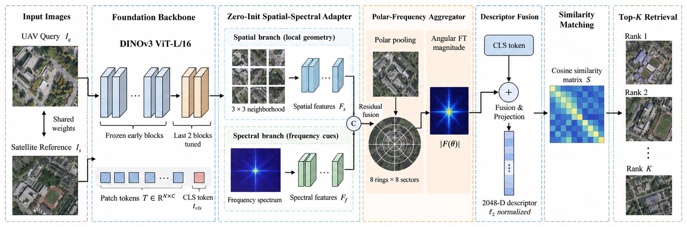

# SSP-DINO-Net: Spatial–Spectral and Polar-Frequency Enhanced DINOv3 Network for UAV-to-Satellite Cross-View Geo-Localization

[Code repository](https://github.com/getmonsky/SP-DINO-Net)

If you find our work useful, please consider giving this repository a ⭐.

## Overview

SSP-DINO-Net addresses UAV-to-satellite cross-view geo-localization under differences in imaging scale, field of view, spatial-frequency statistics, and UAV heading. It builds on a remote-sensing-pretrained **DINOv3 ViT-L/16**, with the final two Transformer blocks trainable, and introduces two complementary modules:

- **Zero-Init Spatial–Spectral Adapter (ZSSA):** combines local spatial interactions with frequency-domain modulation. Zero-initialized residual scales preserve the initial pretrained representation.
- **Polar–Frequency Aggregator (PFA):** partitions adapted patch features into radial–angular bins and aggregates angular Fourier magnitudes to reduce sensitivity to heading variations.

A fused 2048-dimensional, L2-normalized descriptor supports cosine-similarity retrieval against georeferenced satellite images.

## Framework



*Overview of the proposed SSP-DINO-Net framework.*

## Highlights

- **Remote-sensing-pretrained DINOv3:** leverages transferable visual representations while fine-tuning only the final two Transformer blocks.
- **Spatial–spectral adaptation:** ZSSA combines local spatial interactions and frequency-domain modulation with zero-initialized residual scaling.
- **Polar–frequency aggregation:** PFA models radial–angular structure and angular Fourier magnitudes to improve descriptor consistency under heading variations.
- **Cross-view retrieval:** a compact 2048-dimensional descriptor is used for UAV-to-satellite geo-localization.

## Results

SSP-DINO-Net is evaluated on **UAV-VisLoc** and **SUES-200**. On UAV-VisLoc (302 UAV queries and 2,205 satellite gallery images), the model achieves **98.79% R@1** and **95.84% AP** on average over three random seeds. On SUES-200, R@1 reaches **79.08%, 88.90%, 92.61%, and 94.10%** at 150, 200, 250, and 300 m, respectively.

## Datasets

- **UAV-VisLoc:** 11,685 training pairs across 1,204 training locations; evaluation uses 302 queries and 2,205 gallery images. 
- **SUES-200:** 120 training and 80 test places; images at 150, 200, 250, and 300 m. A single model is jointly trained across altitudes and evaluated separately at each altitude.

Obtain datasets from their respective official distributors. Dataset images and pretrained weights should be obtained from their respective official distributors.

## Implementation Details

| Setting | Value |
|---|---|
| Backbone | Remote-sensing-pretrained DINOv3 ViT-L/16 |
| Trainable backbone | Last 2 Transformer blocks |
| Input size | 512 × 512 |
| Descriptor size | 2048 |
| ZSSA frequency bands | 3 |
| PFA | 8 radial rings × 8 angular sectors |
| Optimizer | AdamW |
| Head learning rate | 5e-5 |
| Backbone learning rate | 5e-6 |
| Weight decay | 1e-4 |
| UAV-VisLoc epochs | 35 |
| SUES-200 epochs | 40 |
| GPU reported | NVIDIA RTX 3090, 24 GB |
| Precision | 16-bit mixed precision |

## Code

The implementation is currently being organized and will be released after the paper is published.

## Repository Structure

The planned code organization is shown below. Source files and executable scripts will be provided with the code release.

```text
SSP-DINO-Net/
├── README.md
├── configs/                 # Experiment configurations
├── datasets/                # Dataset loaders and preprocessing
├── models/
│   ├── backbone/            # DINOv3 feature encoder
│   ├── adapters/            # Zero-Init Spatial–Spectral Adapter (ZSSA)
│   ├── aggregators/         # Polar–Frequency Aggregator (PFA)
│   └── network/             # SSP-DINO-Net model
├── losses/                  # Cross-view retrieval objectives
├── tools/                   # Training and evaluation entry points
├── utils/                   # Shared utilities
└── assets/                  # Figures used in this README
```

## Third-Party Resources

SSP-DINO-Net uses DINOv3 and public UAV-to-satellite geo-localization benchmarks. Please follow the licenses and citation requirements of the corresponding pretrained models, datasets, and third-party software.
